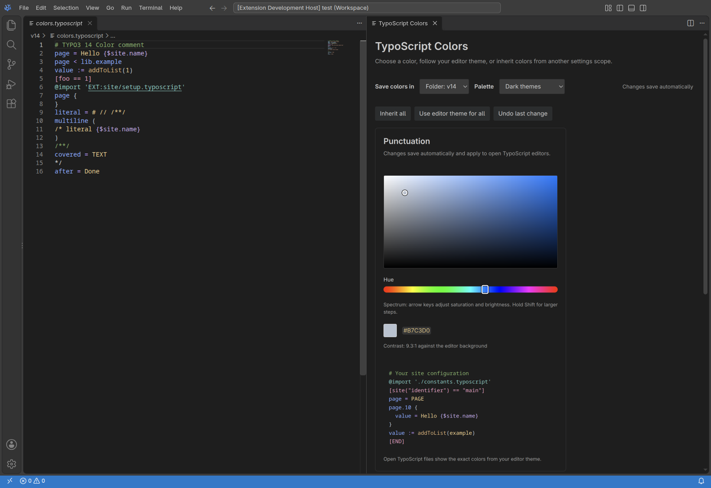
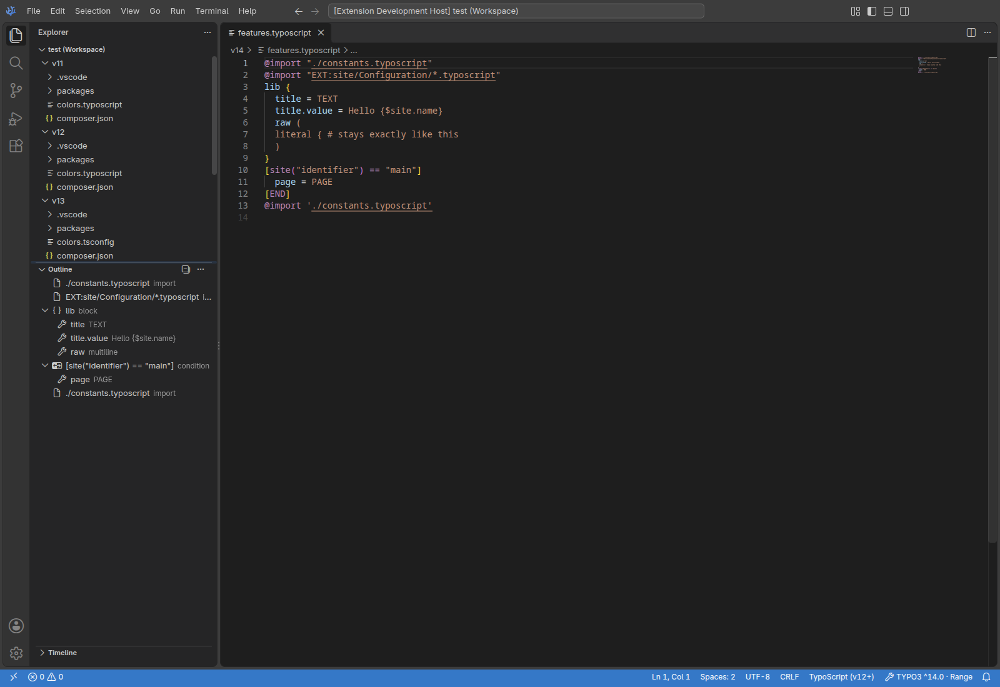
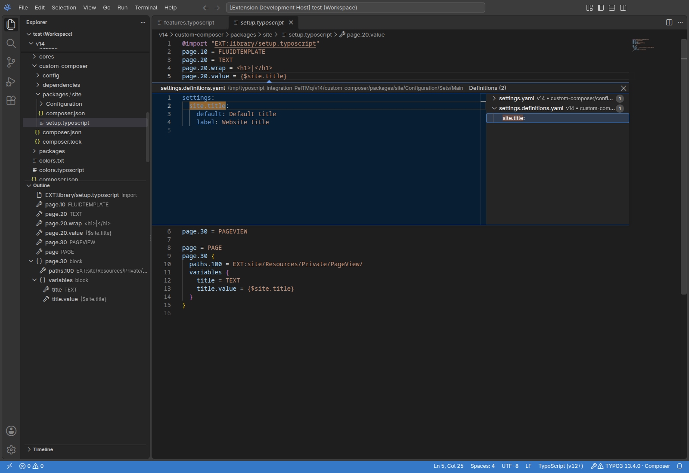
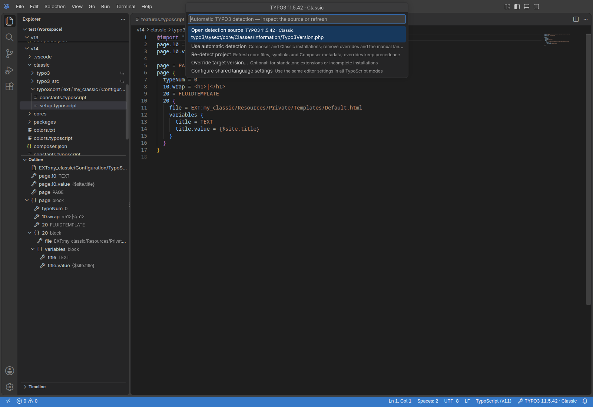
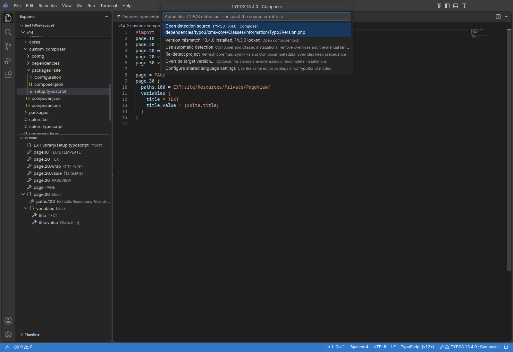
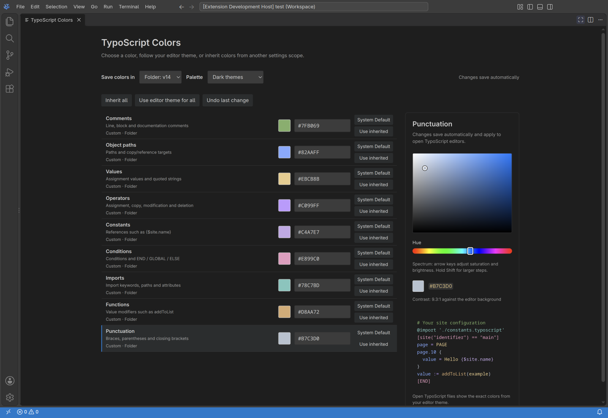
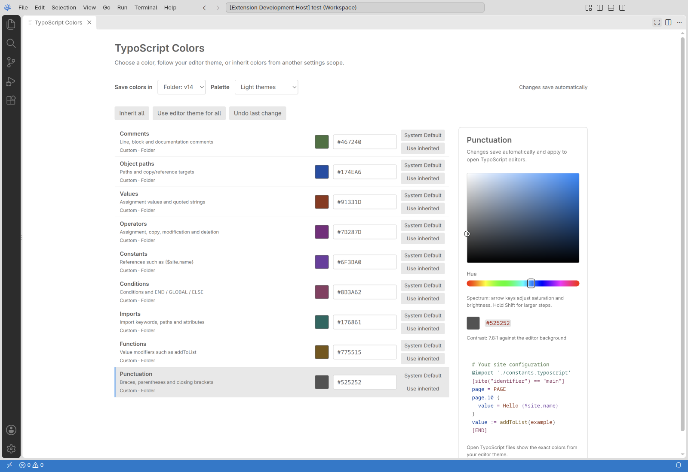

# TypoScript Highlighting

TypoScript and TSconfig support for **Visual Studio Code and VSCodium**, with TYPO3-aware highlighting, project navigation and configurable colors.

Version **1.5.0** automatically detects Composer and Classic TYPO3 installations, including active `typo3_src` symlinks. It adds version-aware core suggestions and YAML site-settings navigation. No version setting is needed for a complete project.

[Install](#installation) · [Get started](#quick-start) · [Navigation](#navigate-your-project) · [Colors](#customize-colors) · [Settings](#settings-reference)

[](images/screenshots/custom-colors-dark.png)

*Actual VSCodium screenshots. Custom foreground colors are optional; a fresh installation follows your editor theme.*

## Installation

Download **typoscript-highlighting-1.5.0.vsix** from [GitHub Releases](https://github.com/StefanSofka/typoscript-highlighting/releases/latest), then run **Extensions: Install from VSIX…** in the Command Palette. Alternatively:

```bash
# VSCodium
codium --install-extension typoscript-highlighting-1.5.0.vsix

# Visual Studio Code
code --install-extension typoscript-highlighting-1.5.0.vsix
```

The extension is also listed on the [Visual Studio Marketplace](https://marketplace.visualstudio.com/items?itemName=stefan-sofka.typoscript-highlighting) and [Open VSX](https://open-vsx.org/extension/stefan-sofka/typoscript-highlighting). Registry versions are published separately from GitHub releases.

Requires a VS Code-compatible editor with API version **1.70 or newer**. No separate Node.js, PHP or Composer installation is needed. Available core files and Composer metadata identify your project and TYPO3 version without running project code.

## Quick start

1. Open your TYPO3 project or Sitepackage folder.
2. Open a `.typoscript` or `.tsconfig` file. Highlighting starts automatically.
3. Check the **TYPO3 version indicator** in the status bar. Its tooltip explains the detected version, installation type, source file and any mismatch with the lockfile. Click it to inspect detection.
4. Ctrl+click an `@import` path, open **Outline**, or invoke completion with **Ctrl+Space**.

## Navigate your project

[](images/screenshots/project-navigation.png)

### Imports

Ctrl+click a quoted import path to open the file. On macOS, use Cmd+click. Supported project paths include:

```typoscript
@import './constants.typoscript'
@import 'EXT:site_package/Configuration/TypoScript/setup.typoscript'
@import 'EXT:site_package/Configuration/TypoScript/*.typoscript'
```

Wildcard and directory imports offer a file picker when several files match. Matches are sorted by filename. `EXT:` paths are resolved from extension Composer manifests, including `packages/`, installed vendor packages and conventional `typo3conf/ext/` locations. An extension's `extra.typo3/cms.extension-key` is preferred; extension package names provide a fallback. Classic extensions in `typo3conf/ext/` and the active core's `typo3/sysext/` also resolve by directory name without a Composer manifest. Detected custom webroots and vendor directories are respected.

Modern imports follow TYPO3's file-level wildcard rules. Parent traversal and directory-level wildcards are not resolved. See the [TYPO3 import reference](https://docs.typo3.org/m/typo3/reference-typoscript/main/en-us/Syntax/FileImports/Index.html).

### Outline and folding

Outline shows object blocks, assignments, imports, conditions and multiline values. Folding understands these structures, block comments and `# region` / `# endregion` markers. Comment-looking text and braces inside literal values do not become structural blocks.

### Constants and snippets

For a reference such as `{$site.name}`:

- **Go to Definition** opens matching project definitions.
- **Find All References** searches project TypoScript and TSconfig files, plus imported sources.
- **Hover** shows definitions, source files and values as written.
- **Ctrl+Space** inside `{$…}` suggests matching constant paths.

Definition lookup follows imports and discovers conventional `constants.typoscript`, `*.constants.typoscript` and `constants.txt` files under the detected project root. Results are source definitions, not evaluated runtime values: database templates, conditions and TYPO3's final override order are not evaluated.

At the start of a statement, completion offers snippets for object blocks, multiline values, imports and conditions. TypoScript files also offer `text`, `coa` and `fluid`; `.tsconfig` files offer `tceform` and `tcedefaults`.

### Core suggestions and site settings

After `page.10 = `, completion suggests common core content objects. After declaring `page.10 = TEXT`, `page.10.` suggests properties such as `value` and `wrap`, including inside object blocks. `config` and explicit `stdWrap` paths have focused suggestions. Each suggestion links to the TYPO3 reference. PAGEVIEW suggestions respect its introduction in TYPO3 13.1 when the exact version is known. Custom objects and properties remain valid.

Constant navigation, hover and completion also read scalar settings from:

- Composer sites: `config/sites/<site>/settings.yaml` and the `settings` section of `config.yaml`.
- Classic sites: `typo3conf/sites/<site>/settings.yaml` and the `settings` section of `config.yaml`.
- Site sets: `Configuration/Sets/<set>/settings.yaml` and scalar defaults in `settings.definitions.yaml`.

Both dotted maps and nested settings trees work. Hover labels definitions and defaults with their source files; several sites may define the same key. These are project candidates, not a reconstructed active site or final runtime value. YAML aliases, custom tags, imports and set dependency order are not resolved. Unsaved YAML edits update navigation and hover.

[](images/screenshots/site-settings-navigation.png)

### Diagnostics and migration

The Problems view reports incomplete object blocks, multiline values, comments and condition brackets, imports that cannot be resolved in the project, and relevant legacy import syntax. Conditions may end implicitly at the end of a file, as TYPO3 allows.

`<INCLUDE_TYPOSCRIPT: …>` is deprecated since TYPO3 13.4 and removed in TYPO3 14. For a simple compatible file import, **Quick Fix → Replace with @import** performs the migration. Imports with extra attributes or incompatible file types require manual migration.

Advisory warnings also identify the removed core `TEMPLATE` object and `PAGEVIEW` on exact targets older than 13.1. Custom extension implementations may supply these names, so these hints do not block editing.

Project import resolution depends on the files available to the editor. You can disable diagnostics for a folder when its dependencies are supplied elsewhere.

## Automatic TYPO3 detection

Open your project and start editing. Detection works independently for each installation, including nested projects and multi-root workspaces. An extension's compatibility range does not hide its enclosing TYPO3 installation.

| Installation | Version source |
| --- | --- |
| Composer | Installed `vendor/typo3/cms-core/Classes/Information/Typo3Version.php`; otherwise `vendor/composer/installed.json`, `composer.lock`, then a `composer.json` requirement. Configured `vendor-dir` and TYPO3 `web-dir` paths are respected. |
| Classic / Legacy | The active `typo3/sysext/core/Classes/Information/Typo3Version.php` or `typo3_src/typo3/sysext/core/Classes/Information/Typo3Version.php`, through symlinks or in a copied core. Conventional `public/`, `web/` and `htdocs/` layouts also work. |

[](images/screenshots/automatic-detection-classic.png)

The installed core takes precedence over lockfiles. A mismatch is visible in the status bar and detection details, with actions to open both sources. A lockfile result is labelled **Locked**, while a manifest requirement is labelled **Range**. A range never claims an exact installed version. Inactive `typo3_src-…` archives are ignored.

[](images/screenshots/automatic-detection-composer.png)

Core files are read as text; PHP and Composer are never executed. Filesystem events refresh detection. A small check of the core version every three seconds also handles symlink switches omitted by editor file watchers. Window focus and **Re-detect project** refresh cached metadata. No recursive polling is performed.

TYPO3 11 uses legacy comments. TYPO3 12–14 share modern comment rules. Ambiguous, missing or unsupported versions use the documented modern fallback; an incomplete nested installation does not borrow an unrelated parent's version.

### Optional target override

A standalone extension may support several TYPO3 versions without a local installation. In this case, click the indicator or run **TypoScript Highlighting: Inspect TYPO3 Detection**, then choose **Override target version…**. The override is saved for the active folder, or in User settings for a standalone file. **Use automatic detection** removes the override and manual language pin.

The advanced `typoscriptHighlighting.typo3Version` setting remains compatible (`auto`, `v11`, `v12`, `v13`, `v14`); leave it at its default for complete projects. The old `commentRules` setting is honored when `typo3Version` has not been explicitly configured.

Manually selecting **TypoScript (v11)** or **TypoScript (v12+)** pins that document. Choose **TypoScript**, or **Use automatic detection**, to resume detection. Automatic choices remain automatic after restarts. Explicit overrides take precedence over a manual pin while preserving detected project paths for navigation.

### Shared language settings

The three language IDs are required to support different comment grammars in a mixed-version workspace. Editor overrides written only under `[typoscript]` do not automatically apply to the version-specific modes.

Run **TypoScript Highlighting: Configure Shared Language Settings** to copy an existing `[typoscript]` override at your chosen scope into the combined override. Existing shared options are preserved; copied generic options take precedence. Future edits can use this shared block:

```json
{
  "[typoscript][typoscript-v11][typoscript-v12]": {
    "editor.tabSize": 4,
    "editor.insertSpaces": true
  }
}
```

The command preserves the original override. More specific individual language overrides remain subject to the editor's normal precedence rules.

## Customize colors

Run **TypoScript Highlighting: Configure Colors**. The spectrum, hex fields and open TypoScript editors update together. The dialog starts with **User** settings and remembers your selected scope and palette.

[](images/screenshots/color-picker-dark.png)

### Scope and inheritance

Choose **User**, **Workspace**, or **Folder: …** as the save destination. Each row identifies the color's origin and indicates when a more specific setting or active theme palette overrides it for the active file.

| Action | Result at the selected scope |
| --- | --- |
| Enter `#RRGGBB` or use the spectrum | Save a custom color. |
| **System Default**, or clear the field | Save an explicit empty value, forcing the editor theme over inherited extension colors. |
| **Use inherited** | Remove the local override and use inherited colors again. |

**Inherit all** and **Use editor theme for all** apply the corresponding action to all nine categories at that scope and palette. **Undo last change** restores the exact previous local values, including whether a setting was absent. Undo history belongs to the open dialog.

Valid hex entries save immediately. The picker also accepts six digits without `#`; incomplete or invalid input displays an error and is not saved. Spectrum arrow keys adjust saturation and brightness; hold **Shift** for larger steps.

### Base, dark and light palettes

The **Base** palette applies to all themes. Optional **Dark themes** and **Light themes** palettes override individual categories for the corresponding theme type. Missing categories inherit the base palette; **System Default** explicitly follows the editor theme. High-contrast themes use the matching dark or light palette.

[](images/screenshots/color-picker-light.png)

The preview helps compare custom category colors, and the contrast indicator compares the selected color with the current editor background. Open TypoScript editors show the exact theme syntax colors.

## Settings reference

Search Settings for `typoscriptHighlighting`. All extension options can be configured per resource.

| Setting | Default | Purpose |
| --- | --- | --- |
| `typoscriptHighlighting.typo3Version` | `"auto"` | Advanced optional override; complete Composer and Classic projects detect automatically. |
| `typoscriptHighlighting.colors.*` | `""` | Base foreground colors for nine syntax categories. |
| `typoscriptHighlighting.darkColors` | `{}` | Optional category overrides for dark themes. |
| `typoscriptHighlighting.lightColors` | `{}` | Optional category overrides for light themes. |
| `typoscriptHighlighting.diagnostics.enabled` | `true` | Structural errors, project import warnings and migration hints. |
| `typoscriptHighlighting.formatting.enabled` | `false` | Opt in to conservative indentation formatting. |

The nine category keys are `comments`, `objectPaths`, `values`, `operators`, `constants`, `conditions`, `imports`, `functions` and `punctuation`.

```json
{
  "typoscriptHighlighting.colors.comments": "#7FB069",
  "typoscriptHighlighting.colors.constants": "#C4A7E7",
  "typoscriptHighlighting.lightColors": {
    "comments": "#467240",
    "constants": "#6F3BA0"
  }
}
```

Native theme settings are not rewritten. Existing legacy `custom` selections and their `customColors` object remain supported; new picker edits use direct hex values.

### Optional formatting

Enable `typoscriptHighlighting.formatting.enabled`, then use **Format Document**. Formatting adjusts leading indentation on recognized code lines using the editor's tab size and insert-spaces options. It preserves assignment values, multiline value content and line endings. Documents with structural errors are left for you to repair first.

This is indentation formatting, not a complete TypoScript rewrite or a runtime validator.

## Troubleshooting

### A legacy file has no highlighting

Automatic recognition covers `.typoscript` and `.tsconfig`. Select **TypoScript** manually for a legacy file or add workspace associations:

```json
{
  "files.associations": {
    "setup.txt": "typoscript",
    "constants.txt": "typoscript"
  }
}
```

### Comment markers stay part of a value

Everything after `=` is a literal assignment value. A multiline value starts with `(` directly after the object path, without `=`:

```typoscript
page.10.value = Hello # this is literal text
page.20.value (
  Hello {$site.name}
  # This is literal text too.
)
```

`page.10.value = (` is a single-line assignment. These distinctions follow TYPO3's [operator syntax](https://docs.typo3.org/m/typo3/reference-typoscript/main/en-us/Syntax/Operators/Index.html).

### A color edit seems to have no effect

Check the selected save scope, Base/Dark/Light palette and the row's origin/override indication. Use **Use inherited** to remove a local override; use **System Default** to explicitly select theme colors.

### An import cannot be resolved

Check that the extension is available in the detected installation. Its Composer extension key or Classic directory name must match the `EXT:` path. Modern imports use `./` or `EXT:`, a quoted path and wildcards only in the filename. The extension does not run TYPO3 to discover database or backend-managed configuration.

For update errors, open **View → Output → TypoScript Highlighting**. When [reporting an issue](https://github.com/StefanSofka/typoscript-highlighting/issues/new), include a small example, TYPO3/editor versions, version-indicator source, relevant settings and a screenshot.

## Development and contributions

See the [development guide](docs/development.md), [project review](docs/project-review.md) and [development log](docs/development-log.md). Tests cover real TextMate tokenization, incremental updates, project structure, settings inheritance, editor providers and visible foreground colors in isolated editor profiles.

## License

[MIT](LICENSE) © Stefan Sofka.
