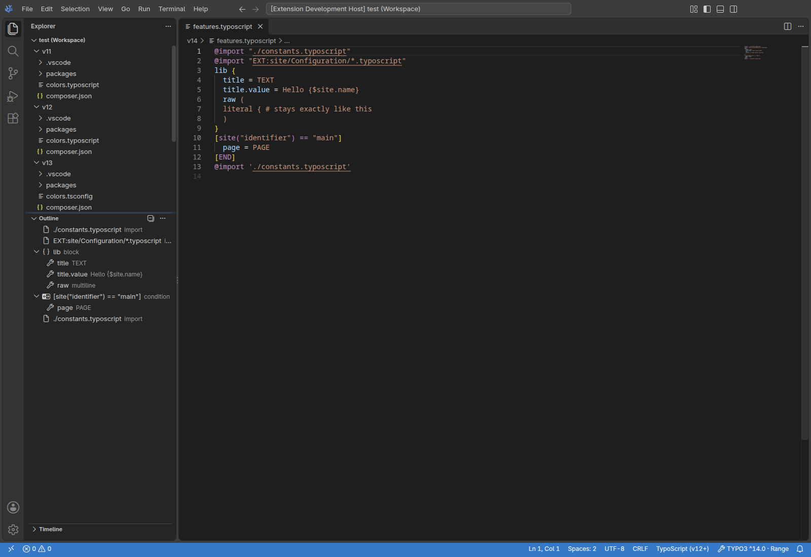
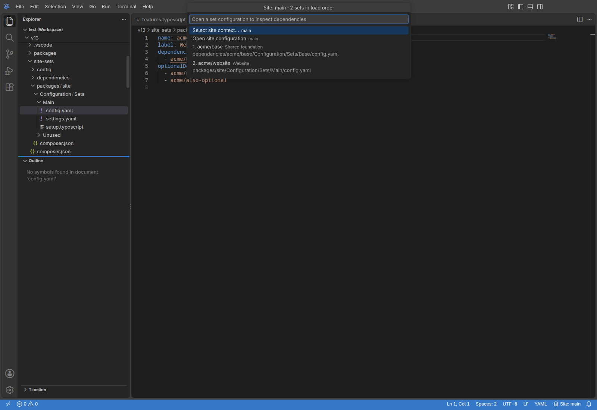
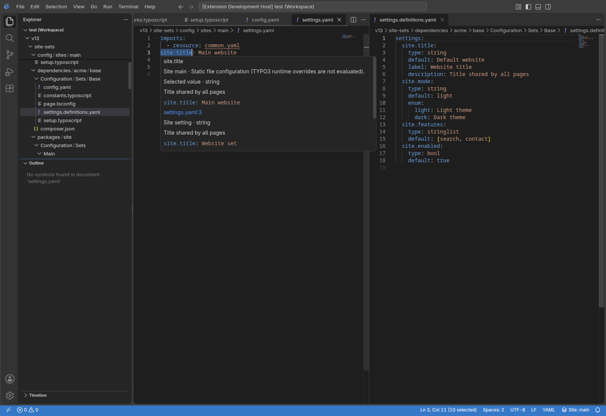
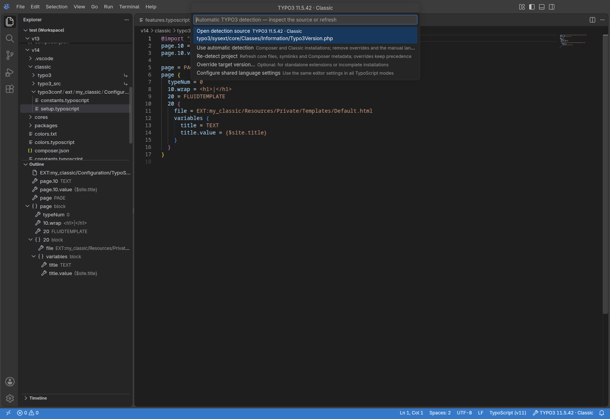
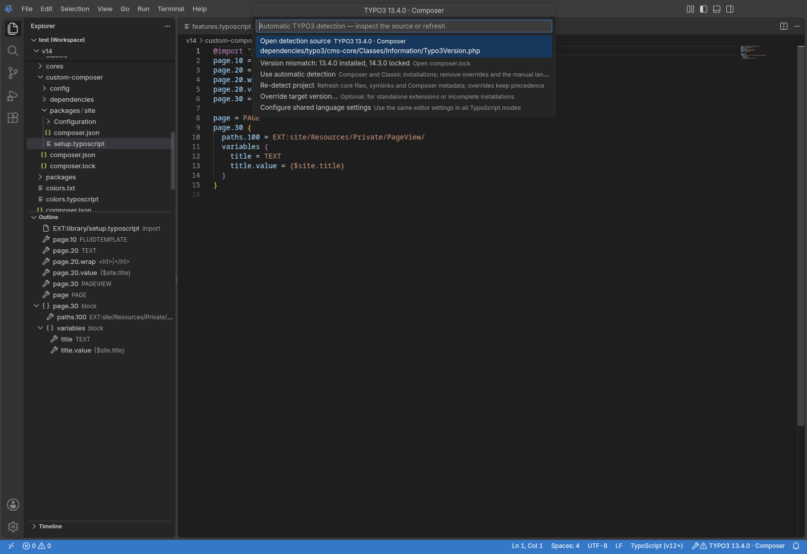
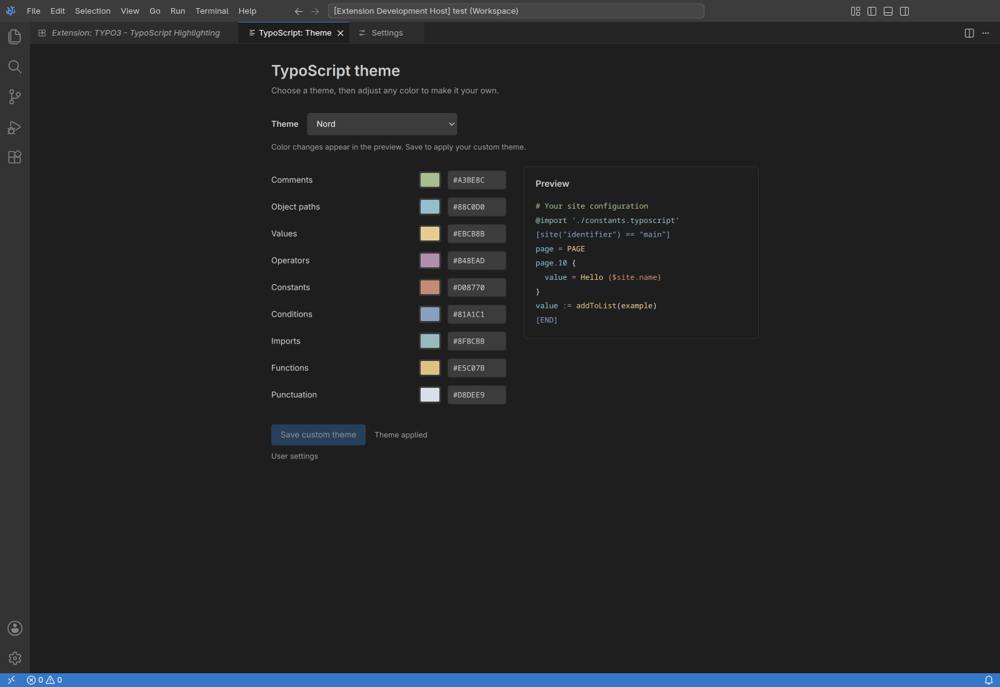
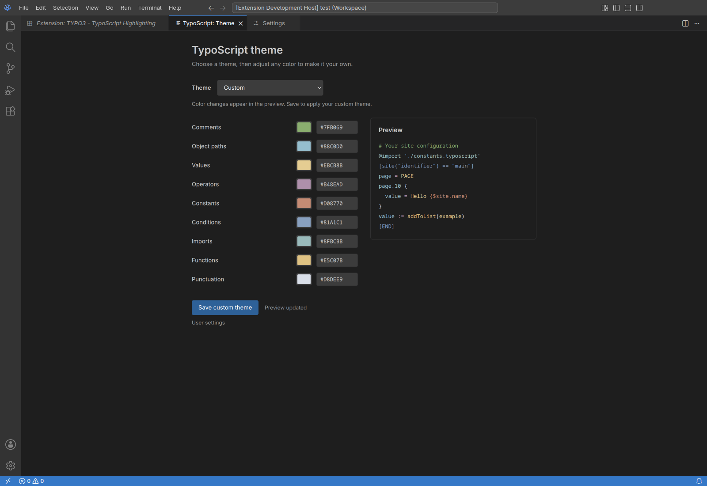
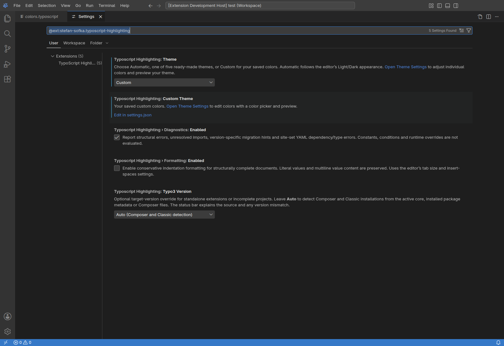

# TypoScript Highlighting

TypoScript and TSconfig support for **Visual Studio Code and VSCodium**, with TYPO3-aware highlighting, project navigation and configurable colors.

Highlighting works immediately after installation, with automatic Light/Dark colors and five ready-made themes. Choose a theme, adjust any of its nine colors and preview the result in one visual editor. Site-set dependencies, typed YAML settings and project navigation are included. Composer and Classic TYPO3 installations are detected automatically, including active `typo3_src` symlinks.

[Install](#installation) · [Get started](#quick-start) · [Navigation](#navigate-your-project) · [Colors](#customize-colors) · [Settings](#settings-reference)

[](images/screenshots/custom-theme.png)

*Actual VSCodium screenshots. A fresh installation automatically selects Light or Dark syntax colors to match the editor color mode.*

## Installation

Download **typoscript-highlighting-1.8.0.vsix** from the [GitHub release 1.8.0](https://github.com/StefanSofka/typoscript-highlighting/releases/tag/v1.8.0), then run **Extensions: Install from VSIX…** in the Command Palette. Alternatively, install the downloaded file from a terminal:

```bash
# VSCodium
codium --install-extension typoscript-highlighting-1.8.0.vsix

# Visual Studio Code
code --install-extension typoscript-highlighting-1.8.0.vsix
```

The extension is also listed on the [Visual Studio Marketplace](https://marketplace.visualstudio.com/items?itemName=stefan-sofka.typoscript-highlighting) and [Open VSX](https://open-vsx.org/extension/stefan-sofka/typoscript-highlighting). Registry versions are published separately from GitHub releases.

Requires a VS Code-compatible editor with API version **1.70 or newer**. No separate Node.js, PHP or Composer installation is needed. Available core files and Composer metadata identify your project and TYPO3 version without running project code.

## Quick start

1. Open your TYPO3 project or Sitepackage folder.
2. Open a `.typoscript` or `.tsconfig` file. Highlighting starts automatically with the matching Light or Dark colors.
3. Check the **TYPO3 version indicator** in the status bar. Its tooltip explains the detected version, installation type, source file and any mismatch with the lockfile. Click it to inspect detection.
4. For site-set navigation, check the **Site** or **Set** indicator. Click it to choose a site when several sites share your code.
5. Ctrl+click an `@import` path, open **Outline**, or invoke completion with **Ctrl+Space**.

## Navigate your project

[](images/screenshots/project-navigation.png)

### Imports

Ctrl+click a quoted import path to open the file. On macOS, use Cmd+click. Supported project paths include:

```typoscript
@import './constants.typoscript'
@import 'EXT:site_package/Configuration/TypoScript/setup.typoscript'
@import 'EXT:site_package/Configuration/TypoScript/*.typoscript'
```

Wildcard and directory imports offer a file picker when several files match. Matches are sorted by filename. `EXT:` paths are resolved from extension Composer manifests, including `packages/`, installed vendor packages and conventional `typo3conf/ext/` locations. An extension's `extra.typo3/cms.extension-key` is preferred; extension package names provide a fallback. Classic extensions in `typo3conf/ext/` and the active core's `typo3/sysext/` also resolve by directory name without a Composer manifest. Detected custom webroots and vendor directories are respected.

Modern imports follow TYPO3's file-level wildcard rules. Parent traversal and directory-level wildcards are not resolved. See the [TYPO3 import reference](https://docs.typo3.org/m/typo3/reference-typoscript/main/en-us/Syntax/FileImports/Index.html).

### Outline and folding

Outline shows object blocks, assignments, imports, conditions and multiline values. Folding understands these structures, block comments and `# region` / `# endregion` markers. Comment-looking text and braces inside literal values do not become structural blocks.

### Constants and snippets

For a reference such as `{$site.name}`:

- **Go to Definition** opens matching project definitions.
- **Find All References** searches project TypoScript and TSconfig files, plus imported sources.
- **Hover** shows definitions, source files and values as written.
- **Ctrl+Space** inside `{$…}` suggests matching constant paths.

Definition lookup follows imports and discovers conventional `constants.typoscript`, `*.constants.typoscript` and `constants.txt` files under the detected project root. Results are source definitions, not evaluated runtime values: database templates, conditions and TYPO3's final override order are not evaluated.

At the start of a statement, completion offers snippets for object blocks, multiline values, imports and conditions. TypoScript files also offer `text`, `coa` and `fluid`; `.tsconfig` files offer `tceform` and `tcedefaults`.

### Core suggestions

After `page.10 = `, completion suggests common core content objects. After declaring `page.10 = TEXT`, `page.10.` suggests properties such as `value` and `wrap`, including inside object blocks. `config` and explicit `stdWrap` paths have focused suggestions. Each suggestion links to the TYPO3 reference. PAGEVIEW suggestions respect its introduction in TYPO3 13.1 when the exact version is known. Custom objects and properties remain valid.

### Site sets and typed settings

For TYPO3 site sets, the extension reads the declared names in `Configuration/Sets/<set>/config.yaml`, resolves required and available optional dependencies, and shows sets in dependency load order. Hidden sets remain available as dependencies. Set names identify the configuration, independently of Composer package names and directory names. See the [TYPO3 site-set reference](https://docs.typo3.org/m/typo3/reference-coreapi/13.4/en-us/ApiOverview/SiteHandling/SiteSets.html).

The **Site** or **Set** indicator in the status bar identifies the context used for navigation:

- A file inside a site's directory uses that site.
- A set used by one site automatically uses that site's context. Shared sets otherwise use their own dependencies and defaults.
- Other project files use the only site when there is one. With several sites, run **TypoScript Highlighting: Select Site Context** or click the indicator to choose one.

The choice is remembered per project. Select **Automatic file context** to remove it; files inside a site's directory always use their containing site. **TypoScript Highlighting: Inspect Site Sets** lists the selected site's sets in load order and opens their configuration files.

[](images/screenshots/site-sets-load-order.png)

Definition and reference searches include the selected sets' `constants.typoscript`, `setup.typoscript` and `page.tsconfig`, their imports, and the corresponding local site files. TypoScript and TSconfig sources stay separate. Unused sets and other sites do not contribute candidates.

Constant navigation, hover and completion read settings from:

- Composer sites: `config/sites/<site>/settings.yaml` and the `settings` section of `config.yaml`.
- Classic sites: `typo3conf/sites/<site>/settings.yaml` and the `settings` section of `config.yaml`.
- Selected site sets: `Configuration/Sets/<set>/settings.yaml`, inline `settings` in `config.yaml`, and defaults in `settings.definitions.yaml`.

Both dotted maps and nested settings trees work, including list values and bounded local YAML aliases. Each set contributes its defaults followed by its own values; the selected site's values follow the sets. A provider's `settings.yaml` replaces its inline `settings` section. Hover identifies the selected static value, type, description, allowed values, defaults and source history. Unsaved YAML edits update the results.

The same navigation works with direct getters and `insertData` references, including multiline values:

```typoscript
page.10.data = siteSettings:site.title
page.20.value = {siteSettings:site.title}
page.20.insertData = 1
page.30.value = {$site.title}
```

In YAML, **Go to Definition**, **Find All References**, links and completion connect dependency names to their set configurations and setting keys to their typed definitions. Completion offers setting types, booleans, enum values and known setting keys. Replacing a name preserves surrounding YAML syntax; replacing a value preserves its trailing comment.

[](images/screenshots/site-sets-settings.png)

Static YAML imports support relative, absolute and `EXT:` paths. Filename wildcards require `glob: true`; `ignore_missing: true` permits an absent resource. Cycles and unresolved resources receive diagnostics. Set `config.yaml` and `settings.definitions.yaml` do not process imports. See [TYPO3 setting definitions](https://docs.typo3.org/m/typo3/reference-coreapi/13.4/en-us/ApiOverview/SiteHandling/SiteSettingDefinitions.html) for types and enum syntax.

The selected value describes the available static files. Environment placeholders, custom YAML tags, conditions, database templates and runtime overrides are not evaluated. A `readonly` setting can still be edited in YAML; that flag controls TYPO3's backend editor.

### Diagnostics and migration

The Problems view reports incomplete object blocks, multiline values, comments and condition brackets, imports that cannot be resolved in the project, and relevant legacy import syntax. Conditions may end implicitly at the end of a file, as TYPO3 allows.

Site-set YAML diagnostics identify malformed configuration, missing required dependencies, duplicate set names, dependency/import cycles, unknown setting types and incompatible values. Missing optional dependencies are allowed. Enum warnings are advisory; they do not discard an otherwise valid typed value.

`<INCLUDE_TYPOSCRIPT: …>` is deprecated since TYPO3 13.4 and removed in TYPO3 14. For a simple compatible file import, **Quick Fix → Replace with @import** performs the migration. Imports with extra attributes or incompatible file types require manual migration.

Advisory warnings also identify the removed core `TEMPLATE` object and `PAGEVIEW` on exact targets older than 13.1. Custom extension implementations may supply these names, so these hints do not block editing.

Project import resolution depends on the files available to the editor. You can disable diagnostics for a folder when its dependencies are supplied elsewhere.

## Automatic TYPO3 detection

Open your project and start editing. Detection works independently for each installation, including nested projects and multi-root workspaces. An extension's compatibility range does not hide its enclosing TYPO3 installation.

| Installation | Version source |
| --- | --- |
| Composer | Installed `vendor/typo3/cms-core/Classes/Information/Typo3Version.php`; otherwise `vendor/composer/installed.json`, `composer.lock`, then a `composer.json` requirement. Configured `vendor-dir` and TYPO3 `web-dir` paths are respected. |
| Classic / Legacy | The active `typo3/sysext/core/Classes/Information/Typo3Version.php` or `typo3_src/typo3/sysext/core/Classes/Information/Typo3Version.php`, through symlinks or in a copied core. Conventional `public/`, `web/` and `htdocs/` layouts also work. |

[](images/screenshots/automatic-detection-classic.png)

The installed core takes precedence over lockfiles. A mismatch is visible in the status bar and detection details, with actions to open both sources. A lockfile result is labelled **Locked**, while a manifest requirement is labelled **Range**. A range never claims an exact installed version. Inactive `typo3_src-…` archives are ignored.

[](images/screenshots/automatic-detection-composer.png)

Core files are read as text; PHP and Composer are never executed. Filesystem events refresh detection. A small check of the core version every three seconds also handles symlink switches omitted by editor file watchers. Window focus and **Re-detect project** refresh cached metadata. No recursive polling is performed.

TYPO3 11 uses legacy comments. TYPO3 12–14 share modern comment rules. Ambiguous, missing or unsupported versions use the documented modern fallback; an incomplete nested installation does not borrow an unrelated parent's version.

### Optional target override

A standalone extension may support several TYPO3 versions without a local installation. In this case, click the indicator or run **TypoScript Highlighting: Inspect TYPO3 Detection**, then choose **Override target version…**. The override is saved for the active folder, or in User settings for a standalone file. **Use automatic detection** removes the override and manual language pin.

The optional `typoscriptHighlighting.typo3Version` setting accepts `auto`, `v11`, `v12`, `v13` and `v14`; leave it at its default for complete projects. Existing legacy version overrides are preserved automatically when old settings are migrated.

Manually selecting **TypoScript (v11)** or **TypoScript (v12+)** pins that document. Choose **TypoScript**, or **Use automatic detection**, to resume detection. Automatic choices remain automatic after restarts. Explicit overrides take precedence over a manual pin while preserving detected project paths for navigation.

### Shared language settings

The three language IDs are required to support different comment grammars in a mixed-version workspace. Editor overrides written only under `[typoscript]` do not automatically apply to the version-specific modes.

Run **TypoScript Highlighting: Configure Shared Language Settings** to copy an existing `[typoscript]` override at your chosen scope into the combined override. Existing shared options are preserved; copied generic options take precedence. Future edits can use this shared block:

```json
{
  "[typoscript][typoscript-v11][typoscript-v12]": {
    "editor.tabSize": 4,
    "editor.insertSpaces": true
  }
}
```

The command preserves the original override. More specific individual language overrides remain subject to the editor's normal precedence rules.

## Customize colors

Open the gear or context menu of the installed **TYPO3 - TypoScript Highlighting** extension and choose **Theme Settings**, or run **TypoScript Highlighting: Theme Settings** from the Command Palette. This opens the visual theme page directly.

The page always shows one **Theme** dropdown, all nine color fields, the code preview and **Save custom theme**. The extension's **Theme Settings** menu item appears before the editor's built-in **Settings** item.

[View the Theme Settings entry in the extension menu.](images/screenshots/theme-settings-menu.png)

Choose **Theme**:

| Choice | Result |
| --- | --- |
| **Automatic (Light / Dark)** | Follow the editor's light or dark appearance. This is the installation default. |
| **Dark**, **Light**, **Nord**, **Monokai**, **Solarized** | Use the complete ready-made theme. |
| **Custom** | Use your own syntax colors. |

[](images/screenshots/theme-switcher.png)

A preset uses its complete palette. Your saved custom colors remain available when you switch back to **Custom**. Nord, Monokai and Solarized adapt to light and dark editors. These themes affect TypoScript and TSconfig foreground colors; the editor keeps its background and workbench appearance. Automatic follows OS changes when the editor follows the operating system.

### Create your own theme

Choose a preset as your starting point, then adjust any color by clicking its swatch or entering a six-digit hex value such as `#467240`. The dropdown switches to **Custom** automatically and the other eight colors stay as they are. You can also select **Custom** to continue your own palette.

The preview updates while you edit. **Save custom theme** applies your changes. Switching to a preset and back to Custom retains an unsaved custom draft while this editor remains open. Close the editor without saving to discard the draft. Selecting an unchanged preset applies it immediately; Save stays visible but is disabled because there are no custom changes to save.

[](images/screenshots/theme-adjusted.png)

The theme editor normally saves personal User settings. When the active file already has an explicit project theme or project colors, it edits those project settings; a plain label identifies the destination. Opening or closing the editor leaves custom colors unchanged unless you save them. Selecting a ready-made theme applies that selection immediately.

### Existing color settings

Existing color and version settings are moved automatically into one **Custom Theme** data entry at their original User, Workspace or Folder scope. Existing values in that entry take precedence. The old entries are removed only after the replacement has been saved successfully. The migration preserves the active theme choice and does not edit other workspaces.

Older color configurations keep their previous behavior until you explicitly select a Theme. A ready-made theme uses its complete palette; Custom restores your saved custom colors. The visual editor has one custom palette. No manual JSON changes are needed for the normal workflow.

### Built-in Settings access

Open the extension's gear menu and choose **Settings**, or search Settings for `@ext:stefan-sofka.typoscript-highlighting`. This page contains only the Theme dropdown, one Custom Theme data entry, Diagnostics, Formatting and the optional TYPO3 Version override.

Select a ready-made theme directly in the dropdown. Follow **Open Theme Settings** to adjust colors with swatches and the live code preview. The nine duplicate hex fields and older skin/palette/version controls are no longer listed. **Custom Theme** stores the saved palette and compatibility data; use the visual editor to change colors, or its JSON link for advanced inspection.

[](images/screenshots/theme-settings.png)

## Settings reference

Use **Theme Settings** for colors and preview. The normal extension Settings page contains these five entries:

| Setting | Default | Purpose |
| --- | --- | --- |
| `typoscriptHighlighting.theme` | `"auto"` | Automatic, a preset (`dark`, `light`, `nord`, `monokai`, `solarized`), or `custom`. |
| `typoscriptHighlighting.customTheme` | `{}` | Stored custom palette and migrated compatibility values. Use **Open Theme Settings** for visual editing; JSON access is available for advanced inspection. |
| `typoscriptHighlighting.typo3Version` | `"auto"` | Optional target override; complete Composer and Classic projects detect automatically. |
| `typoscriptHighlighting.diagnostics.enabled` | `true` | Structural, import, migration and YAML diagnostics. |
| `typoscriptHighlighting.formatting.enabled` | `false` | Opt in to conservative indentation formatting. |

The visual editor manages nine categories: comments, object paths, values, operators, constants, conditions, imports, functions and punctuation. Saving a custom theme writes them together under `customTheme.colors`. Migrated legacy data stays in the same entry for compatibility. The extension does not rewrite native editor theme or token-color settings.

### Optional formatting

Enable `typoscriptHighlighting.formatting.enabled`, then use **Format Document**. Formatting adjusts leading indentation on recognized code lines using the editor's tab size and insert-spaces options. It preserves assignment values, multiline value content and line endings. Documents with structural errors are left for you to repair first.

This is indentation formatting, not a complete TypoScript rewrite or a runtime validator.

## Troubleshooting

### A legacy file has no highlighting

Automatic recognition covers `.typoscript` and `.tsconfig`. Select **TypoScript** manually for a legacy file or add workspace associations:

```json
{
  "files.associations": {
    "setup.txt": "typoscript",
    "constants.txt": "typoscript"
  }
}
```

### Comment markers stay part of a value

Everything after `=` is a literal assignment value. A multiline value starts with `(` directly after the object path, without `=`:

```typoscript
page.10.value = Hello # this is literal text
page.20.value (
  Hello {$site.name}
  # This is literal text too.
)
```

`page.10.value = (` is a single-line assignment. These distinctions follow TYPO3's [operator syntax](https://docs.typo3.org/m/typo3/reference-typoscript/main/en-us/Syntax/Operators/Index.html).

### A color edit seems to have no effect

In **Theme Settings**, editing a field switches to Custom and updates the preview; click **Save custom theme** to apply it. A ready-made theme uses its own complete palette. Check the destination label if a project has its own theme settings. The normal Settings page shows the selected Theme and Custom Theme data at User / Workspace / Folder scope; a project value can override a personal value.

### An import cannot be resolved

Check that the extension is available in the detected installation. Its Composer extension key or Classic directory name must match the `EXT:` path. Modern imports use `./` or `EXT:`, a quoted path and wildcards only in the filename. The extension does not run TYPO3 to discover database or backend-managed configuration.

### A setting shows a value from a different site

Check the **Site** or **Set** indicator and run **TypoScript Highlighting: Select Site Context** to choose the intended site. **Automatic file context** removes a saved choice. A file inside a site's directory always uses that site; a shared set without a selected site uses its own defaults and dependencies. Hover identifies the context and source of each candidate.

For update errors, open **View → Output → TypoScript Highlighting**. When [reporting an issue](https://github.com/StefanSofka/typoscript-highlighting/issues/new), include a small example, TYPO3/editor versions, version-indicator source, relevant settings and a screenshot.

## Development and contributions

See the [development guide](docs/development.md), [project review](docs/project-review.md) and [development log](docs/development-log.md). Tests cover real TextMate tokenization, incremental updates, project structure, settings inheritance, editor providers and visible foreground colors in isolated editor profiles.

## License

[MIT](LICENSE) © Stefan Sofka.
