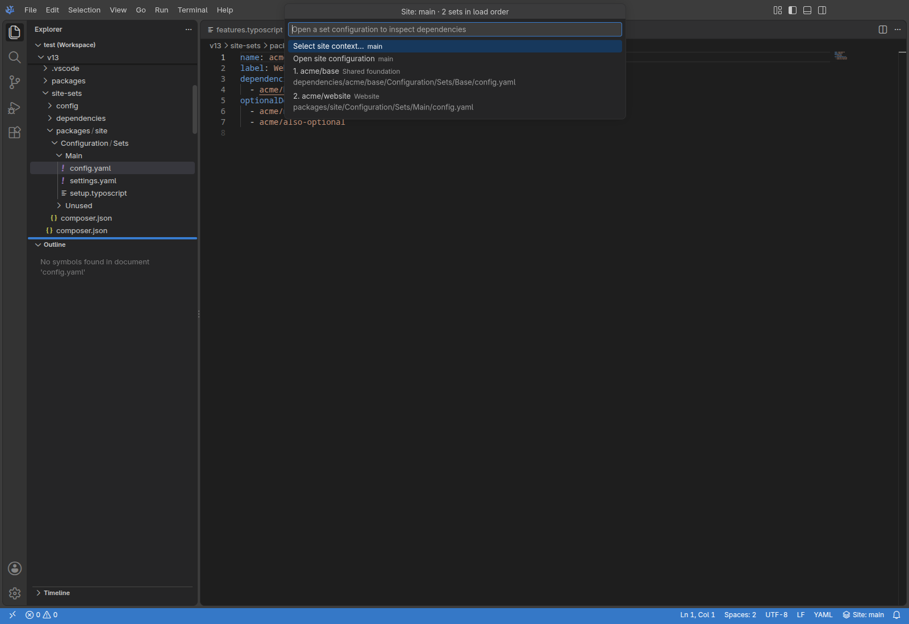
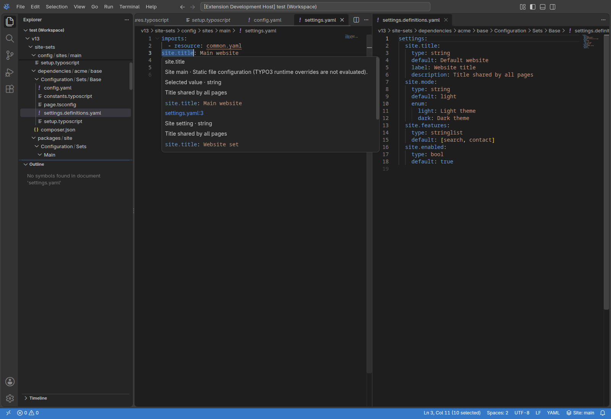
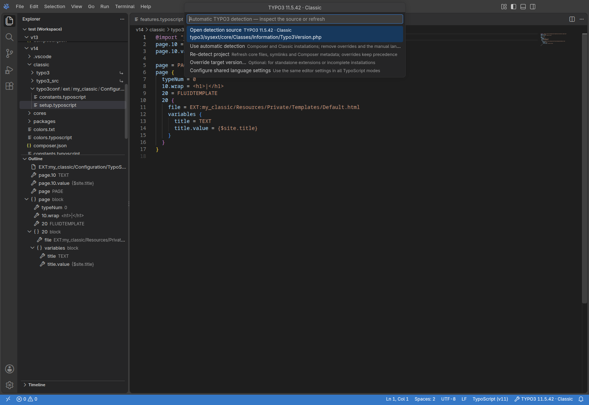
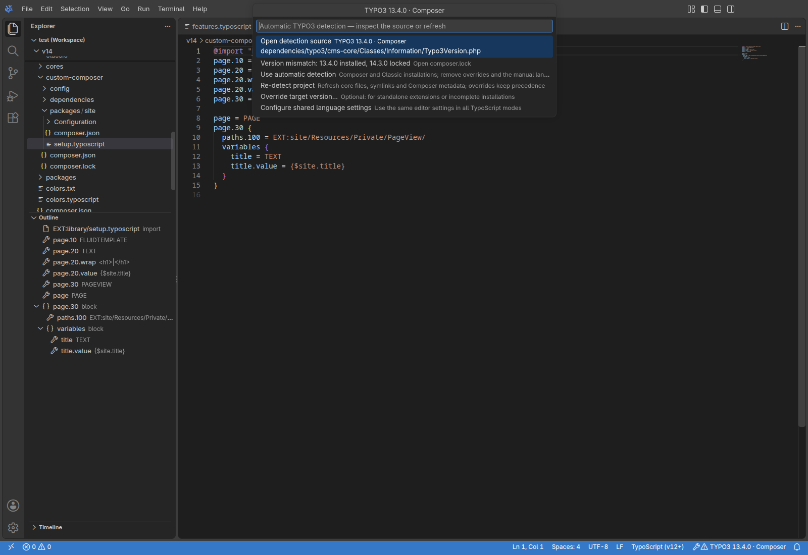
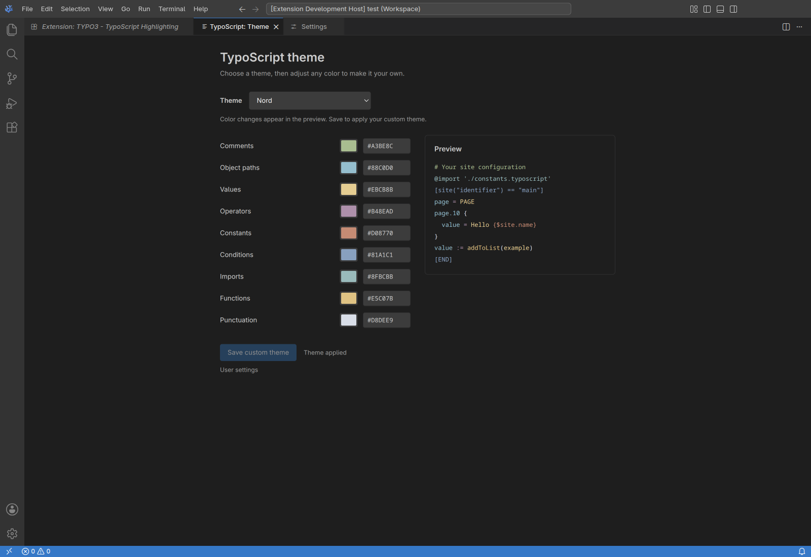
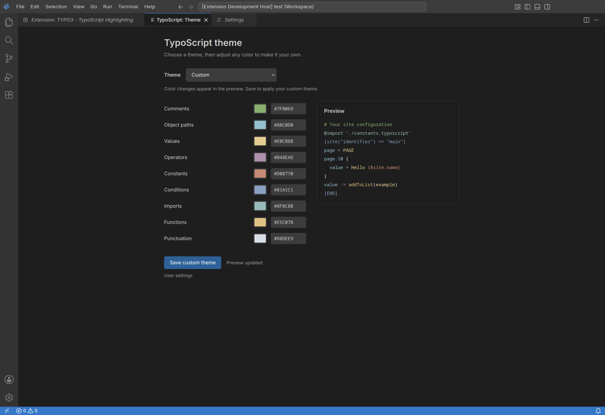
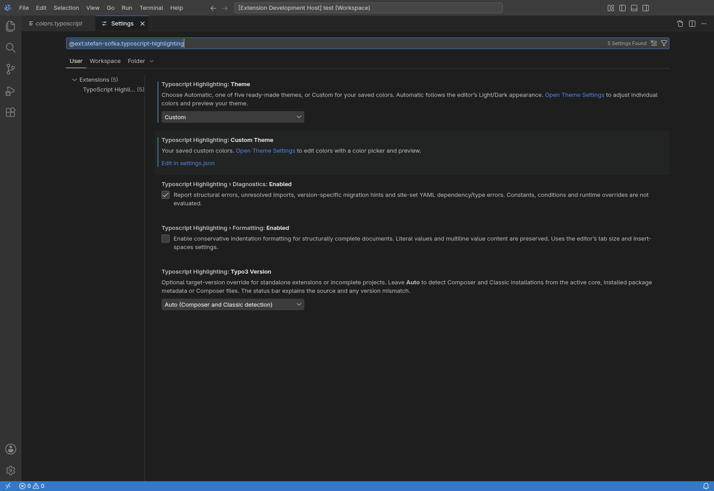

# User guide

[README](../README.md) · [Settings reference](../README.md#settings-reference) · [Development](development.md)

This guide describes the current extension. Release changes are in the [changelog](../CHANGELOG.md); earlier behavior and test results are in the [development log](development-log.md).

## Project navigation

### Imports

Ctrl+click a quoted path to open its source; use Cmd+click on macOS.

```typoscript
@import './constants.typoscript'
@import 'EXT:site_package/Configuration/TypoScript/setup.typoscript'
@import 'EXT:site_package/Configuration/TypoScript/*.typoscript'
```

Wildcard and directory imports offer a file picker when several files match. Matches are sorted by filename. Modern TypoScript imports support one `*` in the filename. Parent traversal and directory wildcards are rejected, including Windows-style traversal.

`EXT:` resolution uses Composer extension keys, package-name fallbacks, editable `packages/` directories, installed vendor packages and conventional Classic extension directories. Classic `typo3conf/ext/` and active core `typo3/sysext/` directories also work without Composer manifests. Configured webroots and vendor directories are respected.

### Outline, folding and constants

Outline lists blocks, assignments, imports, conditions and multiline values. Folding includes these structures, block comments and `# region` / `# endregion` markers.

For `{$site.name}`, **Go to Definition**, **Find All References**, **Hover** and **Ctrl+Space** connect references to project definitions. Lookup follows imports and discovers conventional `constants.typoscript`, `*.constants.typoscript` and `constants.txt` files. Conditions and TYPO3 runtime override order are not evaluated.

Statement completion includes object blocks, multiline values, imports and conditions. Setup files also offer `text`, `coa` and `fluid` snippets; TSconfig files offer `tceform` and `tcedefaults`.

### Core suggestions and diagnostics

Completion after `page.10 = ` offers common core objects. After `page.10 = TEXT`, `page.10.` suggests properties, including inside object blocks. Focused suggestions also cover `config` and explicit `stdWrap` paths. Suggestions link to the TYPO3 reference; custom names remain valid.

Problems reports incomplete structures, unresolved imports and supported migration hints. Conditions may end at EOF. Simple `<INCLUDE_TYPOSCRIPT: …>` file imports offer **Quick Fix → Replace with @import** for modern targets; imports with extra attributes require manual migration.

Formatting is opt-in through [Settings](../README.md#settings-reference). It changes leading indentation in structurally complete files and preserves literal values and line endings.

## Site sets and YAML settings

The registry reads declared names from `Configuration/Sets/<set>/config.yaml` and resolves required and available optional dependencies. Names are independent of Composer package names and directory names. Hidden sets remain usable as dependencies.

[](../images/screenshots/site-sets-load-order.png)

The **Site** or **Set** status indicator shows the navigation context:

- Files inside a site's directory use that site.
- A set used by one site uses that site's context. Shared sets otherwise use their own dependencies and defaults.
- Other project files use the only site when one exists. With several sites, run **TypoScript Highlighting: Select Site Context** or click the indicator.

The selection is remembered per project. **Automatic file context** removes it; physical site containment takes precedence. **TypoScript Highlighting: Inspect Site Sets** lists the selected sets in load order and opens their configuration.

Navigation includes selected sets' `constants.typoscript`, `setup.typoscript` and `page.tsconfig`, their imports and corresponding site files. TypoScript and TSconfig sources remain separate. Unused sets and unrelated sites are excluded.

### Values and definitions

| Provider | Files |
| --- | --- |
| Composer site | `config/sites/<site>/settings.yaml` or inline `settings` in `config.yaml` |
| Classic site | `typo3conf/sites/<site>/settings.yaml` or inline `settings` in `config.yaml` |
| Selected set | `settings.definitions.yaml` defaults, followed by `settings.yaml` or inline `settings` in `config.yaml` |

A provider's `settings.yaml` replaces its inline values. Each set contributes defaults followed by its own values; site values follow the selected sets. Dotted keys, nested trees, lists and bounded local aliases are supported. Unsaved edits update navigation and diagnostics.

```typoscript
page.10.data = siteSettings:site.title
page.20.value = {siteSettings:site.title}
page.20.insertData = 1
page.30.value = {$site.title}
```

Hover identifies the context, selected static value, type, description, allowed values and source history. YAML definition/reference navigation connects settings to their typed defaults and dependencies to their set configurations. Completion preserves neighboring syntax and trailing comments. Hover also works inside multiline YAML values.

[](../images/screenshots/site-sets-settings.png)

### YAML imports and validation

Static YAML imports support relative, absolute and `EXT:` resources. Filename wildcards require `glob: true`; multiple filename wildcards are supported. `ignore_missing: true` permits an absent resource. Set `config.yaml` and `settings.definitions.yaml` do not process imports.

Diagnostics cover malformed configuration, missing required dependencies, duplicate set names, dependency/import cycles, unknown types and incompatible values. Missing optional dependencies are allowed. Enum warnings are advisory. A `readonly` definition controls TYPO3's backend editor and does not prevent editing source YAML.

See the official [site-set reference](https://docs.typo3.org/m/typo3/reference-coreapi/13.4/en-us/ApiOverview/SiteHandling/SiteSets.html) and [setting definitions](https://docs.typo3.org/m/typo3/reference-coreapi/13.4/en-us/ApiOverview/SiteHandling/SiteSettingDefinitions.html).

## TYPO3 version detection

Each installation, nested project and workspace folder is detected separately.

| Installation | Source priority |
| --- | --- |
| Composer | Installed core `Classes/Information/Typo3Version.php`; then `vendor/composer/installed.json`, `composer.lock` and the `composer.json` requirement |
| Classic | Active `typo3/sysext/core/Classes/Information/Typo3Version.php` or `typo3_src/typo3/sysext/core/Classes/Information/Typo3Version.php`, through symlinks or a copied core |

Conventional `public/`, `web/` and `htdocs/` layouts and configured Composer roots work. Inactive archived cores are ignored. Installed-core information wins over lockfiles; mismatches are visible in the status indicator and inspection menu. **Locked** identifies a lockfile result; **Range** identifies a requirement rather than an exact installed version.

[](../images/screenshots/automatic-detection-classic.png)

[](../images/screenshots/automatic-detection-composer.png)

TYPO3 11 uses legacy comments; TYPO3 12–14 share modern rules. Unknown or ambiguous targets use modern rules. An incomplete nested installation does not borrow an unrelated parent's version.

Filesystem events, window focus and **Re-detect project** refresh metadata. A three-second check of the active core version also catches missed symlink switches without recursively polling the project.

### Overrides and language settings

Run **TypoScript Highlighting: Inspect TYPO3 Detection** or click the indicator to inspect sources, re-detect, or choose **Override target version…**. Overrides are intended for standalone extensions and incomplete installations; complete projects normally use automatic detection.

An explicit target overrides a manual language pin. Selecting **TypoScript (v11)** or **TypoScript (v12+)** manually pins that document; selecting **TypoScript** resumes detection. **Use automatic detection** clears the target choice and manual pin.

Language-specific editor settings under `[typoscript]` alone do not automatically cover the version-specific IDs. **TypoScript Highlighting: Configure Shared Language Settings** copies generic settings at the chosen scope into a combined override, retaining existing shared options:

```json
{
  "[typoscript][typoscript-v11][typoscript-v12]": {
    "editor.tabSize": 4,
    "editor.insertSpaces": true
  }
}
```

Copied generic options take precedence over existing shared options. The original override is retained; individual language overrides follow normal editor precedence.

## Themes and custom colors

Run **TypoScript Highlighting: Theme Settings**, or choose **Theme Settings** in the installed extension's gear/context menu. The visual page shows a Theme dropdown, nine editable colors, preview and **Save custom theme**.

[View the extension menu entry.](../images/screenshots/theme-settings-menu.png)

| Choice | Behavior |
| --- | --- |
| Automatic | Match the editor's Light/Dark appearance, including OS changes when the editor follows the OS |
| Dark / Light | Use the complete fixed preset |
| Nord / Monokai / Solarized | Use a complete preset adapted to the editor appearance |
| Custom | Use your saved syntax colors |

[](../images/screenshots/theme-switcher.png)

Selecting a preset applies it immediately. Editing any swatch or six-digit hex value starts a Custom draft and keeps the other eight colors. Editing affects the preview until **Save custom theme** applies the full palette. Switching to presets and back retains a draft while the panel remains open; closing without saving discards it. Saved custom colors remain available when choosing Custom again.

[](../images/screenshots/theme-adjusted.png)

The nine categories are comments, object paths, values, operators, constants, conditions, imports, functions and punctuation. These palettes affect syntax foregrounds; the editor controls its background and workbench appearance.

The panel normally saves User settings. If the active file already has explicit project theme or color data, it continues at that Folder or Workspace scope. Check the destination label when a change seems to affect the wrong project.

### Native Settings and migration

The native page offers the five entries in the [settings reference](../README.md#settings-reference). **Open Theme Settings** opens the visual editor; **Custom Theme** also provides JSON access.

[](../images/screenshots/theme-settings.png)

Older color, skin and version data migrates automatically into `customTheme` at the original User, Workspace or Folder scope. Existing destination members take precedence. Source entries are removed only after saving their replacements. Other workspaces are not rewritten.

Existing color configurations retain their compatibility behavior until you explicitly choose a modern Theme. Presets use their full palette; Custom restores your own colors. Advanced storage details belong to the [architecture guide](project-review.md#settings-and-migration).

## Analysis limits

This is static editing assistance. PHP, Composer, conditions, database templates, custom YAML tags, environment placeholders and final runtime overrides are not evaluated.

Discovery and traversal are bounded: 300 extension roots for set discovery, 500 set/site directories per group, 32 YAML import levels, 500 imported settings loads, 20,000 definitions and 512 KiB of text per YAML file. Alias traversal is bounded. Reference search examines up to 1,000 project files; imported TypoScript source collection stops at 300 readable sources. Large or dynamic installations can therefore have incomplete results.

YAML can intentionally reference static files outside the workspace, and detection can follow configured roots and symlinks. See the [security model](../SECURITY.md#security-model).

## Troubleshooting

| Symptom | What to check |
| --- | --- |
| Legacy `setup.txt` or `constants.txt` lacks highlighting | Select TypoScript manually or add the file associations below. |
| A color edit has no effect | Click **Save custom theme**, then check the destination label and project-level Theme override. |
| An import is unresolved | Check the detected installation, extension key/directory and quoted `./` or `EXT:` path. |
| A value comes from another site | Check the Site/Set indicator and choose a site or **Automatic file context**. |
| The detected version is wrong | Inspect the source and conflicts; use **Re-detect project**, then an optional override if necessary. |

```json
{
  "files.associations": {
    "setup.txt": "typoscript",
    "constants.txt": "typoscript"
  }
}
```

After `=`, comment-looking text belongs to a literal value. A multiline value starts with `(` directly after its object path:

```typoscript
page.10.value = Hello # literal text
page.20.value (
  Hello {$site.name}
  # literal text too
)
```

`page.10.value = (` is a single-line assignment. See the [TYPO3 operator reference](https://docs.typo3.org/m/typo3/reference-typoscript/main/en-us/Syntax/Operators/Index.html).

For update errors, open **View → Output → TypoScript Highlighting**. [Report a reproducible issue](https://github.com/StefanSofka/typoscript-highlighting/issues/new) with a small source example, editor/TYPO3 versions, relevant settings and the detection source. Use the [private security contact](../SECURITY.md#reporting-a-vulnerability) for suspected vulnerabilities.
